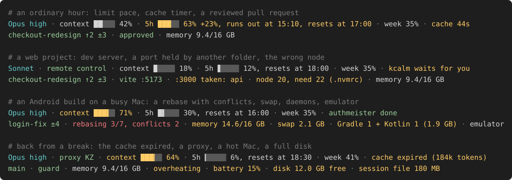

# promptsill

A status line for [Claude Code](https://code.claude.com) that knows about your dev machine, not just your session.



```text
Opus high · remote control · context ██▏   42% · 5h ███▏  63% +23%, runs out at 15:10, resets at 17:00 · week 35% · cache 44s · kcalm waits for you
checkout-redesign ↑2 ±3 · vite :5173 · :3000 taken: api · node 20, need 22 (.nvmrc) · memory 14.6/16 GB · swap 2.1 GB · Gradle 1 + Kotlin 1 (1.9 GB)
```

## What it shows that others don't

The second line is about the project you're in and the machine it runs on. Apart from the branch, each part appears only when it has something to say:

- **Git branch** with commits ahead and behind, `not pushed` and the number of changed files. It's clickable: it opens the pull request when one is open, otherwise the branch page. Next to it, `approved` or `changes requested` once the pull request has a review, and `worktree` when the session runs in a linked git worktree.
- **Unfinished git operations.** `rebasing 3/7, conflicts 2` in the middle of a rebase, and likewise `merging`, `cherry-picking`, `reverting` or `bisecting`. During a rebase the branch shows its own name instead of `(detached)`.
- **Your dev servers.** `vite :5173` when this project's server is running, clickable to open it in the browser.
- **Busy ports.** `:3000 taken: api` when the port your project needs is held by another folder's server.
- **Node version.** `node 20, need 22 (.nvmrc)` when the active `node` doesn't match `.nvmrc`, `.node-version` or `engines`.
- **Memory pressure** on macOS. Used memory and swap, yellow or red when free memory runs low or swap grows.
- **Gradle and Kotlin daemons**, counted separately, with the RAM they hold together: `Gradle 2 + Kotlin 1 (1.9 GB)`. Shown in JVM and Android projects, or anywhere when memory is tight or the daemons hold 1.5 GB or more.
- **iOS simulators and the Android emulator** in mobile projects, so you notice the ones you forgot to close.
- **A slowed-down Mac.** `CPU slowed to 70%` when macOS throttles the CPU, `overheating` on a thermal warning, `low power mode`, and `battery 15%` when the battery is at 20% or less and not charging. A build that suddenly takes twice as long usually has one of these behind it.
- **Low disk space.** `disk 12.0 GB free` once less than 15 GB is left on the home volume, red under 5 GB. Xcode's DerivedData, simulators and Gradle caches eat it quietly.
- **A huge session file**, from 50 MB up.

## The Claude part

The first line is about Claude Code itself.

- **Model, effort and fast mode.** `Opus xhigh fast`. On a narrow terminal only the model name stays.
- **Context** as a bar with 1/8-cell precision.
- **Limit pace.** For the 5-hour and weekly limits, promptsill compares how much you've used with how much of the window has passed. 60% in the first hour of five is a problem; 60% in the last hour is fine. Colors follow the pace, not the raw percentage. `+23%` means you're 23 points ahead of an even pace, and `runs out at 15:10` says when you'll hit the limit if you keep going like this.
- **Spend limit** behind a Claude gateway that sets one: `spend $12/$50`, or a percentage when the gateway doesn't report dollars. Colored by the same pace as the other limits when the gateway says whether the period is a day, a week or a month.
- **Prompt cache timer.** `cache 44s` shortly before the cache expires, and `cache expired (184k tokens)` after it has. The next message after expiry re-reads the whole conversation, here 184k tokens, which costs more of your limit; from 100k up it turns yellow. When the cache was rebuilt for another reason, promptsill says why for five minutes: `cache reset: tools changed`, `system prompt changed`, `model changed`, `history rewritten` or `server side`.
- **Remote Control.** `remote control` while the session is reachable from claude.ai or the Claude app, clickable to open it there. Claude Code doesn't pass this to status lines, so promptsill reads it from Claude Code's own session files in `~/.claude/sessions/`. That's an internal format; if a future version changes it, the label just stops appearing.
- **Proxy.** `proxy KZ` when the session's network goes through a proxy (`HTTPS_PROXY` or `ALL_PROXY` in the environment Claude Code runs with), red `proxy KZ down` when a proxy on this machine stops answering. The country comes from `PROMPTSILL_PROXY_LABEL`, which the tool that starts the proxy sets after checking the exit; promptsill itself makes no requests to find it out. Without the variable it just says `proxy`.
- **Your other sessions.** `kcalm waits for you` when another Claude Code session on this machine is stuck on a permission prompt or a question, and `authmeister done` for ten minutes after one finishes its turn. Three or more are counted: `3 sessions wait for you`. This also comes from `~/.claude/sessions/`.

When the terminal is narrow, promptsill shortens the parts first, then drops the least important ones. The limits, context and branch stay.

## Install

### Homebrew (macOS, Linux)

```bash
brew install kopylovis/tap/promptsill
promptsill install
```

### Claude Code plugin

```text
/plugin marketplace add kopylovis/promptsill
/plugin install promptsill@promptsill
/promptsill:setup
```

The plugin keeps its copy of promptsill up to date on every session start. Run `/promptsill:setup uninstall` before you uninstall the plugin.

### By hand

```bash
curl -fsSL https://raw.githubusercontent.com/kopylovis/promptsill/main/promptsill -o ~/.local/bin/promptsill
chmod +x ~/.local/bin/promptsill
promptsill install
```

promptsill is a single Python file with no dependencies. It needs `python3` 3.9 or newer, and uses `git`, `lsof`, `ps` and, on macOS, `pmset` when they're available. The cache timer needs Claude Code 2.1.251 or newer; everything else works with older versions.

## Commands

```text
promptsill install [--force] [--lang en|ru]   add the statusLine to ~/.claude/settings.json
promptsill uninstall                          remove it, and bring back the one it replaced
promptsill preview [--lang en|ru] [--width N] render sample data for the current folder
promptsill badge set|clear|list ...           labels from hooks and scripts, see below
promptsill --version
```

`install` never replaces another status line unless you pass `--force`. When you do, the old one is saved and `uninstall` restores it. Before every change, `settings.json` is copied to `settings.json.promptsill-backup`. `CLAUDE_CONFIG_DIR` is respected.

## Settings

Labels are in English by default, and in Russian when your locale (`LC_ALL`, `LC_MESSAGES` or `LANG`) is Russian. To choose explicitly, use `install --lang ru`, the `PROMPTSILL_LANG` environment variable, or the config file.

Optional `~/.config/promptsill/config.json`:

```json
{
  "lang": "en",
  "links": true,
  "color": true,
  "ascii": false
}
```

- `links`: clickable links on the branch, review state, dev servers, Remote Control and badges ([OSC 8](https://gist.github.com/egmontkob/eb114294efbcd5adb1944c9f3cb5feda); iTerm2, Kitty, WezTerm, Ghostty and others, usually with Cmd-click or Ctrl-click; macOS Terminal doesn't support them).
- `color`: `false` turns colors off; so does the `NO_COLOR` environment variable.
- `ascii`: `[##---]` bars for fonts without block characters; also `PROMPTSILL_ASCII=1`.

## Badges from hooks and scripts

Any hook or script can put a short label on the second line, for example to show that a mode is on. A badge is a JSON file in `~/.local/state/promptsill/badges/` (or `$XDG_STATE_HOME/promptsill/badges/`), one file per badge. promptsill shows it on the next refresh and stops showing it when the file is gone.

```json
{"text": "humanize", "color": "green"}
```

Only `text` is required. The other fields:

- `color`: `green`, `yellow`, `red`, `cyan` or `dim`.
- `session`: show the badge only in the Claude Code session with this `session_id`. Hooks get it in their input.
- `cwd`: show it only in this folder and below.
- `expires`: Unix time after which the badge is ignored.
- `url`: makes the badge a clickable link.
- `priority`: 1 to 5, default 2. When the line doesn't fit, higher numbers are dropped first.

The same from the command line:

```bash
promptsill badge set build-mode release --color yellow --cwd ~/app --ttl 3600
promptsill badge clear build-mode
promptsill badge list
```

Names may contain letters, digits, `.`, `_` and `-`. Prefix them with your tool's name so they don't clash. promptsill shows at most 8 badges and strips control characters from the text.

## Privacy

promptsill runs locally and makes no network requests. It reads the JSON Claude Code sends it, the badge files and Claude Code's list of running sessions, runs `git status`, `lsof`, `ps` and `pmset`, and keeps a few seconds of cache in `~/.cache/promptsill`.

## Development

```bash
make test               # unit tests and smoke checks
./promptsill preview    # see the line for the current folder
python3 docs/preview.py # regenerate the pictures in docs/
```

## License

[MIT](LICENSE)
